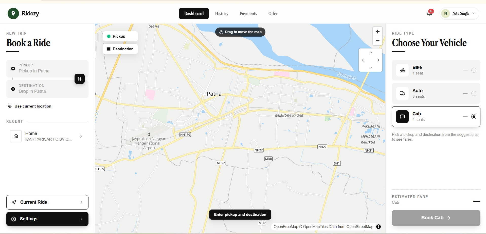
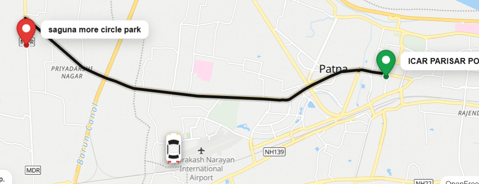
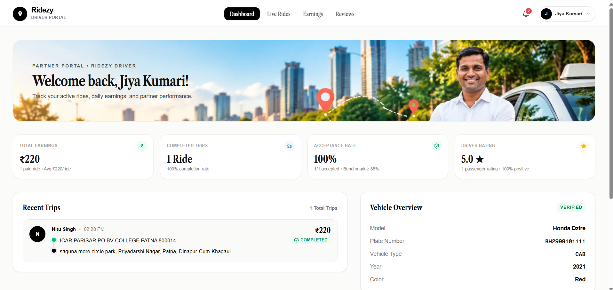
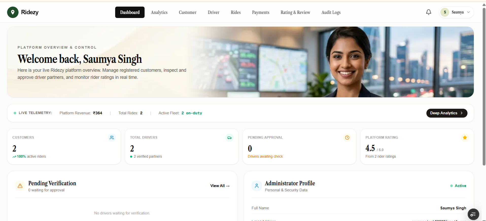
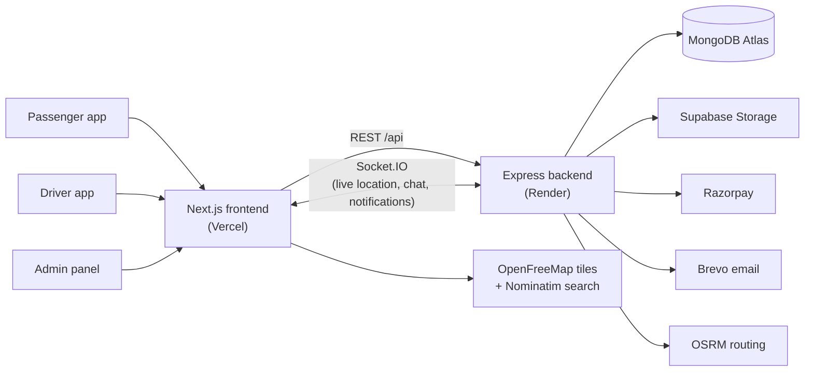

<div align="center">

# 📍 Ridezy

**A full-stack ride-hailing platform for Indian cities: bikes, autos and cabs.**

Passengers book rides and track them live on a map, drivers accept and run trips, and admins verify drivers and monitor the whole platform.


</div>

---

## 📸 Screenshots

| Passenger: book a ride | Driver: live trip map |
| --- | --- |
|  |  |

| Driver dashboard | Admin dashboard |
| --- | --- |
|  |  |

---

## ✨ Features

The platform is built as ten modules, in the order a ride flows through them.

**Legend:** ✅ built and integrated end to end · 🟡 partly built · 🚧 planned

```
1. Authentication ✅
   ├── Register
   ├── Email OTP
   ├── Login / JWT
   ├── RBAC (Passenger · Driver · Admin)
   └── /me
   │
   ▼
2. User & Profile Management ✅
   ├── Passenger profile
   ├── Driver profile
   ├── Vehicle details
   └── Driver documents
   │
   ▼
3. Driver Availability & Location ✅
   ├── Driver online / offline
   ├── Driver current location
   ├── Geospatial location data (MongoDB 2dsphere)
   └── Driver location foundation
   │
   ▼
4. Ride Module ⭐ ✅
   ├── Select pickup address 📍
   ├── Select destination address 📍
   ├── Select vehicle 🚗
   ├── Calculate route & distance
   ├── Calculate fare
   ├── Ride summary
   ├── Book ride
   ├── Search nearby available drivers
   ├── Send ride request
   ├── Driver accept / reject
   ├── Assign driver
   └── Ride lifecycle
   │
   ▼
5. Real-Time System ✅
   ├── Socket.IO
   ├── Assigned driver's live location
   ├── Driver → pickup tracking
   ├── Distance to pickup
   ├── ETA to pickup
   ├── Driver arrival
   ├── Ride status updates
   ├── Passenger live tracking
   ├── Driver → destination tracking
   ├── Chat with assigned driver
   └── Phone call with assigned driver 🟡
   │
   ▼
6. Driver Simulator ✅
   ├── Simulated driver
   ├── Movement
   ├── Route progression
   └── Real-time location events
   │
   ▼
7. Payments ✅
   ├── Payment simulation
   ├── Transactions
   └── Payment status
   │
   ▼
8. Ratings & Reviews
   ├── Passenger → Driver ✅
   └── Driver → Passenger 🚧
   │
   ▼
9. Notifications ✅
   ├── Ride accepted
   ├── Driver arriving
   ├── Driver arrived
   ├── Ride started
   ├── Ride completed
   └── Payments, verification and more
   │
   ▼
10. Admin ✅
    ├── Driver verification
    ├── User management
    ├── Active rides
    ├── Payments
    └── Analytics
```

### Module details

<details>
<summary><b>1. Authentication</b></summary>

- Passengers and drivers register; admin accounts are created only through a CLI script, never over the API.
- **Email OTP verification:** a 6-digit code is sent by email only and is never returned in an API response, so the user must read it from their inbox. Codes are stored as an HMAC (keyed hash), expire after 10 minutes, allow 5 attempts, can be used only once, and have a 60-second resend cooldown.
- Passwords are hashed with bcrypt. Login returns a JWT, and every protected route checks the user's role (RBAC).
- Login gives the same error for an unknown email and a wrong password, so accounts can't be discovered that way.
</details>

<details>
<summary><b>2. User & Profile Management</b></summary>

- Passenger and driver profiles, vehicle details (type, model, plate, year, colour) and driver documents (licence, RC, insurance and so on).
- Profile photos and vehicle images go to a public storage bucket. Driver documents go to a **private** bucket and are only reachable through signed links that expire after 1 hour.
- Uploaded files are checked by their actual content (magic bytes), not just the file extension.
</details>

<details>
<summary><b>3. Driver Availability & Location</b></summary>

- Drivers go online or offline. While online, their location is stored as GeoJSON with a MongoDB `2dsphere` index.
- Nearby search uses `$geoNear` and only returns drivers who are online, verified, have every document verified, and have recently updated their location.
</details>

<details>
<summary><b>4. Ride Module</b></summary>

- Address search uses OpenStreetMap (Nominatim). Road routes and distances come from OSRM, with a straight-line (haversine) fallback if OSRM is down.
- Fares are calculated per vehicle type (bike, auto, cab) from the route distance.
- **Matching:** a ride is offered **only to drivers with the vehicle type the rider chose**. A bike ride never reaches auto or cab drivers. Offers go out in batches, re-matching is limited, and the search times out.
- **Accepting a ride:** the first driver to accept gets it. This happens inside a MongoDB transaction, so two drivers can never be assigned the same ride.
- **Ride lifecycle:** `SEARCHING → DRIVER_ASSIGNED → DRIVER_ARRIVING → DRIVER_ARRIVED → RIDE_STARTED → RIDE_COMPLETED` (or `CANCELLED`). Only valid status changes are allowed. Starting a ride needs a **4-digit ride OTP** that the passenger shares with the driver.
- Riders can add a tip while the ride is active.
</details>

<details>
<summary><b>5. Real-Time System</b></summary>

- Socket.IO connections are authenticated with the user's JWT, and each user gets a private room. Every event is checked against the database again before it's acted on.
- The driver's live location is pushed to the passenger, along with distance and ETA to the pickup. A "driver approaching" notification fires within 500 m of the pickup.
- In-ride chat between the passenger and the assigned driver.
- **Calling 🟡:** the two participants see each other's phone number (tap to call) only while the ride is active. The backend already handles WebRTC call signalling, but the in-app call screen isn't built yet.
</details>

<details>
<summary><b>6. Driver Simulator</b></summary>

- Lets you test a full trip on one machine: the simulated driver follows the real road route to the pickup, then to the destination, at 1×, 5× or 10× speed.
- Tapping "I Have Arrived" puts the car on the pickup point. Each simulated position goes through the same location API as real GPS, so the passenger's live map, ETA and notifications are the real thing.
</details>

<details>
<summary><b>7. Payments</b></summary>

- Cash, plus online payment through Razorpay checkout (with a built-in mock gateway for development and tests).
- Each payment records base fare, tip, taxes, extra charges and discounts, and one function calculates the total.
- Online payments are confirmed by signature verification and a webhook. Cash payments are confirmed by the driver.
- A receipt is emailed when a payment completes. The platform takes an 8% commission on fares only; tips go entirely to the driver.
</details>

<details>
<summary><b>8. Ratings & Reviews</b></summary>

- Passengers rate and review their driver after paying for a completed ride, once per ride. Driver ratings appear on the driver and admin dashboards.
- 🚧 **Planned:** drivers rating passengers.
</details>

<details>
<summary><b>9. Notifications</b></summary>

- 13 notification types covering the ride lifecycle, payments and driver verification.
- Delivered live over Socket.IO with an unread count, plus a notification bell in every navbar.
- Each ride event creates at most one notification, and notifications are deleted automatically after 90 days.
</details>

<details>
<summary><b>10. Admin</b></summary>

- **Driver verification:** review documents and verify, reject (with a reason and the specific documents), suspend or reactivate a driver.
- Manage customers and drivers, and view active rides, payments, ratings and platform analytics (revenue, rides, active drivers).
- **Audit log:** every admin action is recorded with who did it, who it affected and the reason.
</details>

---

## 🛠️ Tech Stack

| Layer | Technology |
| --- | --- |
| **Frontend** | Next.js 16 (App Router), React 19, TypeScript, Tailwind CSS 4, shadcn/ui (Base UI), Lucide icons |
| **Maps** | MapLibre GL JS, OpenFreeMap tiles, OSRM routing, Nominatim geocoding (all OpenStreetMap-based; no API keys) |
| **Backend** | Node.js 22, Express 5, TypeScript, Zod validation |
| **Database** | MongoDB Atlas with Mongoose (transactions, geospatial indexes, TTL indexes) |
| **Real-time** | Socket.IO (JWT handshake, per-user rooms), WebRTC signalling |
| **Auth** | JWT, bcrypt, HMAC-hashed email OTPs, role-based access control |
| **Payments** | Razorpay (checkout, signature verification, webhooks), mock gateway |
| **Email** | Brevo HTTPS API (production), Nodemailer SMTP / Ethereal (development) |
| **Storage** | Supabase Storage (public and private buckets, signed URLs) |
| **Testing** | Node test runner, `mongodb-memory-server` (replica set for transactions), fake OSRM server |
| **Deployment** | Vercel (frontend), Render (backend, see [`render.yaml`](render.yaml)) |

---

## 🏗️ Architecture



The backend is a long-running server rather than serverless functions, because Socket.IO needs connections that stay open.

---

## 🚀 Getting Started

### Prerequisites

- Node.js **22.12+**
- A MongoDB Atlas cluster (transactions need a replica set, which Atlas provides)

### 1. Backend

```bash
cd backend
cp .env.example .env    # set MONGODB_URI, JWT_SECRET and OTP_SECRET at minimum
npm install
npm run dev             # http://localhost:5000
```

Generate each secret with:

```bash
node -e "console.log(require('crypto').randomBytes(48).toString('base64url'))"
```

In development, if no email settings are filled in, emails go to a throwaway Ethereal inbox and a preview link for each one is printed in the server log. Use that link to read your verification code.

Create the admin account (there is no public endpoint for this):

```bash
# set ADMIN_NAME, ADMIN_EMAIL and ADMIN_PASSWORD in .env, then:
npm run create-admin
# then remove ADMIN_PASSWORD from .env
```

### 2. Frontend

```bash
cd ridezy
npm install
npm run dev             # http://localhost:3000
```

The frontend uses `http://localhost:5000/api` by default. To point it elsewhere, set `NEXT_PUBLIC_API_URL` in `ridezy/.env.local` (see [`ridezy/.env.example`](ridezy/.env.example)).

### 3. Try a full ride

1. Register a **passenger** and a **driver** (two browsers, or one normal window and one private window), and verify both emails with the OTP.
2. As the driver, add a vehicle and upload documents. As the admin, verify the driver.
3. The driver goes **online**. The passenger picks a pickup and destination, chooses the **same vehicle type** as the driver's vehicle, and books.
4. The driver accepts, then uses the **drive simulator** to reach the pickup and taps **I Have Arrived**.
5. The passenger reads out the 4-digit ride OTP, the driver starts the trip, simulates the drive and completes it.
6. The passenger pays and rates the driver. The admin sees the ride, payment and rating.

---

## ⚙️ Environment Variables

### Backend (`backend/.env`)

| Variable | Required | Purpose |
| --- | --- | --- |
| `MONGODB_URI` | ✅ | MongoDB Atlas connection string, including the database name |
| `JWT_SECRET` | ✅ | Signs login tokens |
| `OTP_SECRET` | ✅ | HMAC key for email OTPs (must differ from `JWT_SECRET`) |
| `CORS_ORIGIN` | | Allowed frontend origins (default `http://localhost:3000`) |
| `APP_URL` | | Frontend URL used in email links |
| `BREVO_API_KEY`, `EMAIL_FROM` | Production | Email over HTTPS (Brevo) |
| `EMAIL_HOST`, `EMAIL_PORT`, `EMAIL_USER`, `EMAIL_PASSWORD` | | SMTP alternative to Brevo |
| `SUPABASE_URL`, `SUPABASE_SERVICE_ROLE_KEY`, `SUPABASE_PUBLIC_BUCKET`, `SUPABASE_PRIVATE_BUCKET` | | Image and document storage (falls back to local `uploads/`) |
| `PAYMENT_PROVIDER`, `RAZORPAY_KEY_ID`, `RAZORPAY_KEY_SECRET`, `RAZORPAY_WEBHOOK_SECRET` | | Online payments (`mock` in development) |
| `ROUTING_PROVIDER`, `OSRM_BASE_URL` | | `osrm` road routes or `haversine` straight-line estimate |
| `MATCH_ALL_DRIVERS` | | `true` ignores distance and location age when matching (handy for testing). The vehicle type is always enforced. |
| `WEBRTC_ICE_SERVERS` | | STUN/TURN servers for calls |

The full list, with defaults, is in [`backend/.env.example`](backend/.env.example).

### Frontend (`ridezy/.env.local`)

| Variable | Purpose |
| --- | --- |
| `NEXT_PUBLIC_API_URL` | Backend API base URL, e.g. `https://your-backend.onrender.com/api` |

---

## 🧪 Testing & Quality

```bash
cd backend
npm test            # integration tests against an in-memory MongoDB replica set
npm run typecheck
npm run lint
```

The tests cover auth (OTP hashing, expiry, attempt limits, single use, no code in responses), matching by vehicle type, transactional accept and cancel races, the ride lifecycle and ride OTP, payments and tips, ratings, notifications and real-time communication.

**API docs:** with the backend running, open `http://localhost:5000/api/docs` (Swagger UI). A Postman collection is in [`backend/postman/`](backend/postman/). The Socket.IO event contract is in [`backend/docs/realtime-events.md`](backend/docs/realtime-events.md).

---

## ☁️ Deployment

- **Backend → Render.** [`render.yaml`](render.yaml) is a Render Blueprint (Node web service, health check at `/api/health`, WebSockets supported). In Render choose **New → Blueprint**, select this repo and fill in the secrets it asks for. Step-by-step notes are in [`backend/README.md`](backend/README.md#deploy-render).
- **Frontend → Vercel.** Import the repo, set the root directory to `ridezy` and set `NEXT_PUBLIC_API_URL` to your Render URL followed by `/api`.

---

## 👩‍💻 About the Developer

**Saumya Singh**, Full Stack Developer · Computer Science graduate

I'm a Full Stack Developer and Computer Science graduate passionate about building scalable, user-friendly web applications. I have hands-on experience with React, Next.js, TypeScript, Node.js, Express.js, MongoDB, and PostgreSQL. I enjoy solving real-world problems, learning new technologies, and continuously improving my development skills. I'm currently exploring new career opportunities where I can contribute, learn from experienced developers, and grow as a software engineer.

🌐 **Portfolio:** [saumya-singhs-portfolio.vercel.app](https://saumya-singhs-portfolio.vercel.app/)

---

<div align="center">

If you find this project interesting, consider giving it a ⭐

</div>
